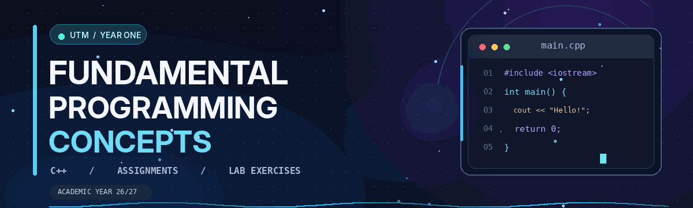
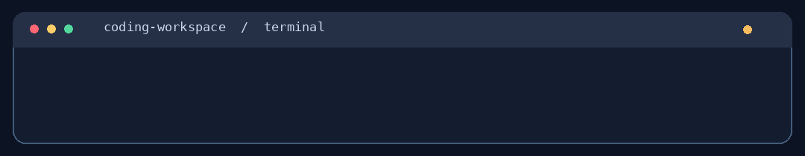

<!-- ═══════════════════════════════════════════════════════════════
  FUNDAMENTAL PROGRAMMING CONCEPTS · PERSONAL LEARNING REPOSITORY
  Visual assets are stored locally in /assets for reliability.
═══════════════════════════════════════════════════════════════ -->

<strong>Degree Year 1 · Universiti Teknologi Malaysia (UTM)</strong> 
<em>An evolving collection of coding assignments, lab exercises, and projects.</em>

✦ About this repository
From understanding a problem to writing working code.

Welcome to my personal repository for Fundamental Programming Concepts. This is where I organize my C++ assignments, lab exercises, coding practice, and project work throughout the 2026/2027 academic year at Universiti Teknologi Malaysia (UTM).

<table>
  <tr>
    <td width="33%" align="center"><b>🎓 COURSE</b> Fundamental Programming Concepts</td>
    <td width="33%" align="center"><b>🧠 MAIN LANGUAGE</b> C++</td>
    <td width="34%" align="center"><b>🛠️ WORKSPACE</b> VS Code · Git · GitHub</td>
  </tr>
</table>🗂️ Explore the repository
<table>
  <tr>
    <td width="50%" valign="top">
      <h3>01 · Assignments</h3>
      
Coursework, source files, flowcharts, and supporting materials.

      
    </td>
    <td width="50%" valign="top">
      <h3>02 · Lab Exercises</h3>
      
Hands-on programming questions, C++ solutions, and practice files.

      
    </td>
  </tr>
  <tr>
    <td width="50%" valign="top">
      <h3>03 · Coding Practice</h3>
      
Small programs built to strengthen programming logic and problem solving.

      
    </td>
    <td width="50%" valign="top">
      <h3>04 · Learning Archive</h3>
      
Previous work and improvements preserved through Git commit history.

      
    </td>
  </tr>
</table>📌 Links to specific folders work once those folders have been pushed to this repository.
⚡ Learning focus
<table>
  <tr>
    <td width="50%" valign="top">
      <b>💡 Foundations</b>  
      Variables, data types, operators, program flow, and basic problem solving.
    </td>
    <td width="50%" valign="top">
      <b>🔁 Control Flow</b>  
      Conditions, loops, debugging, and tracing program behavior.
    </td>
  </tr>
  <tr>
    <td width="50%" valign="top">
      <b>🧩 Functions & Libraries</b>  
      Reusable code, parameters, return values, and standard C++ functions.
    </td>
    <td width="50%" valign="top">
      <b>🧪 Practice & Improvement</b>  
      Reading questions carefully, testing solutions, and refining code.
    </td>
  </tr>
</table>💻 The coding mindset

  

My workflow: Understand → Plan → Write C++ → Run & Test → Fix → Commit

<b>🔎 Click to see my learning goals</b>

 - Track university coding assignments and lab submissions in one organized place.
- Build confidence in C++ programming logic, control structures, and algorithms.
- Improve code readability, documentation, testing, and version-control habits.
- Look back at previous solutions to see how my understanding develops.

<b>🛠️ Click to see tools used</b>

 Tool	How I use it
C++	Write and practice programming solutions
Visual Studio Code	Edit, organize, and run code
Git	Track changes and commit progress
GitHub	Store and manage the repository

<h3>✧ Small steps. Real progress.</h3>
<strong>Keep learning. Keep building. Keep improving.</strong>
Made and maintained by <b>Wong Yan Kang</b> · Universiti Teknologi Malaysia · 2026/2027

